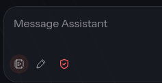
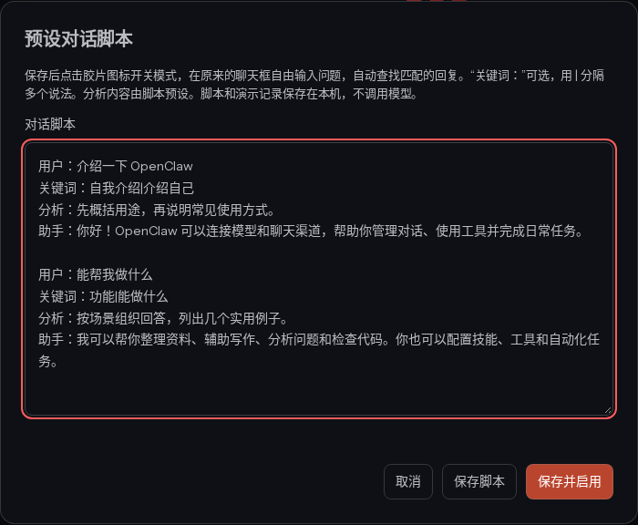
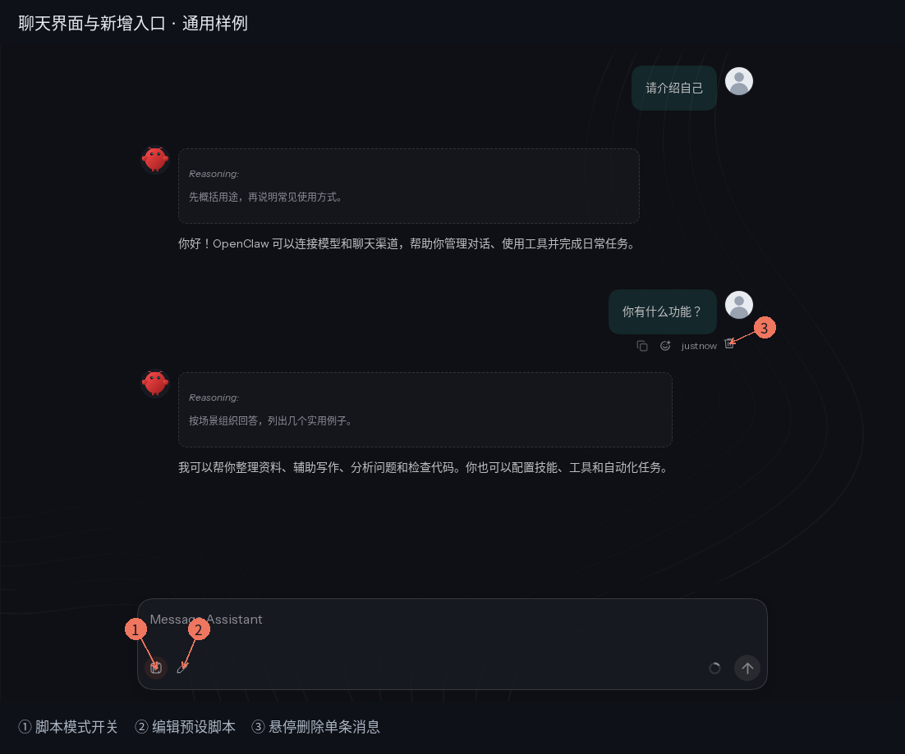
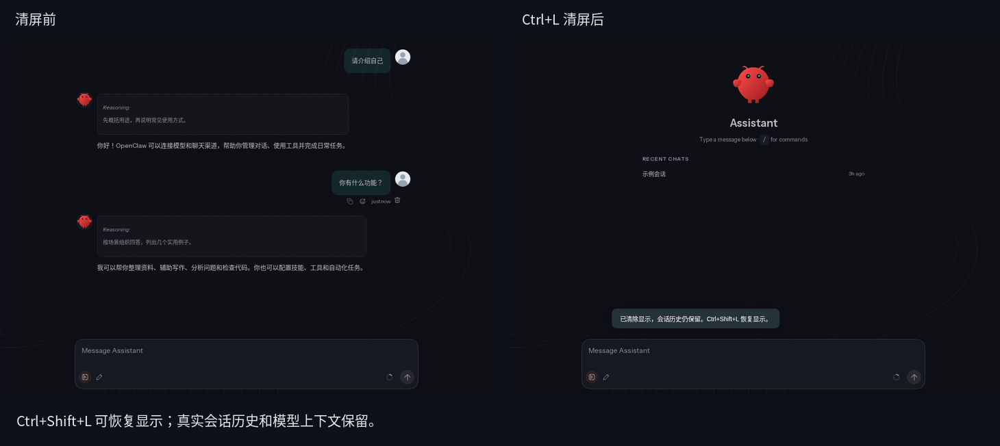

# OpenClaw_sub · OpenClaw 聊天演示定制版

基于本机正在使用的 **OpenClaw 2026.10.5（1b58cb9）** 整理的 Linux amd64 安装包，保留桌面客户端、Gateway、模型接入和聊天界面。本仓库重点提供**预设脚本对话、脚本编辑、聊天视图管理**，方便产品演示、讲解和录屏。

> 预设脚本模式中的“分析”和“回复”均由使用者事先编写，是本地演示内容。开启后匹配脚本播放，不调用真实模型，也不消耗模型 API 额度。关闭后恢复正常模型聊天。

## 输入框旁的三个入口



从左到右：

| 图标 | 功能 | 使用方式 |
| --- | --- | --- |
| 胶片 / 播放 | **开启、关闭预设脚本演示模式** | 点击切换；开启时图标高亮；右键也可打开编辑器。首次没有保存脚本时会先打开编辑器。 |
| 铅笔 | **编辑预设对话脚本** | 打开编辑器，支持“保存脚本”或“保存并启用”。 |
| 盾牌 | **当前会话的执行权限** | OpenClaw 原生权限入口，控制智能体工具在当前会话中的执行权限，与本地脚本开关相互独立。 |

### 1. 预设脚本对话：自由提问，自动匹配

开启胶片图标后，继续使用**原来的聊天输入框**提问。程序按问题、关键词和字面相似度匹配预设条目，无需按照脚本顺序提问。

- 支持同一个问题配置多个关键词，用 `|` 分隔，例如 `自我介绍|介绍自己|你是谁`。
- 匹配后先展示预设分析，再逐字展示预设回复；等待时间随回复长度变化。
- 演示消息直接显示在原生聊天界面里，沿用头像、气泡和分析展示。
- 没有匹配条目时会提示修改问法或补充脚本，**不会自动转为模型调用**。
- 脚本和演示记录保存在当前浏览器或桌面客户端的本机存储中，二者互相独立。
- 刷新页面或切换会话后模式自动关闭；重新开启可恢复当前会话保存的演示记录。
- 演示消息不写入真实模型上下文。关闭模式后，继续正常模型对话。

### 2. 脚本编辑器：问题、关键词、分析、回复一起维护

点击铅笔图标，输入以下格式：

```text
用户：介绍一下 OpenClaw
关键词：自我介绍|介绍自己|你是谁
分析：先说明用途，再简要介绍可以完成的工作。
助手：你好！我是你的 AI 助手，可以帮助你整理资料、编写内容和解决问题。

用户：你有什么功能？
关键词：能做什么|功能介绍
分析：按聊天、模型接入和演示三个方面组织回答。
助手：我支持模型聊天、第三方模型接入，也可以使用预设脚本进行本地演示。
```

每组以“用户：”开始，必须包含“用户”和“助手”；“关键词”和“分析”可以省略。多组之间可留空行，正文支持多行。省略分析时显示默认演示提示。

“保存脚本”只保存内容；“保存并启用”会同时进入演示模式。真实模型正在回复时，需要等待回复结束再开启。



### 3. 盾牌：会话执行权限

盾牌是上游已有的权限控制入口。本版本包含以下会话权限选项，具体是否可选取决于当前账号权限、智能体和后端能力：

| 模式 | 界面说明 |
| --- | --- |
| 默认 | 遵循智能体配置的执行权限。 |
| 只读 | 工具可读取会话根目录内容，无法写入或运行命令。 |
| 受保护 | 超出会话根目录范围的请求由人工审核。 |
| 工作区 | 超出会话根目录范围的请求由 AI 审核。 |
| 完全访问 | 文件操作和命令不受普通审核限制，需要 `operator.admin` 权限。 |

会话权限不会替你新增工具或改变工具配置档，最终执行仍由后端有效策略决定。截图中盾牌的颜色不作为本说明判断当前权限模式的依据，以点击后显示的选项为准。

### 4. 清屏、恢复和单条消息隐藏

| 操作 | 效果 |
| --- | --- |
| `Ctrl+L` | 隐藏当前已有消息，后续新消息正常显示。 |
| `Ctrl+Shift+L` | 恢复隐藏消息，包括单条隐藏的消息。 |
| 悬停消息后点击垃圾桶 | 只隐藏这一条，2 秒内可以点击“撤销”。 |

这些操作仅改变本机显示，保留后台真实会话历史和模型上下文；提示在约 2 秒后消失。Assistant 使用红色小龙虾头像，用户使用灰色默认人像。





## 安装

适用 **Linux x86_64 / amd64、Ubuntu / Debian 桌面系统**，需要 Python 3.9+、apt 和 systemd 用户会话。当前验证环境为 Ubuntu 22.04.5；不支持 Windows、macOS 和 ARM。系统依赖缺失时需要联网，故不是完全离线安装镜像。

1. 到本仓库 [Releases](https://github.com/GCUSMS-AI-ProJect/OpenClaw_Sub/releases) 下载完整 `.tar.gz` 安装包及同名 `.sha256` 文件。
大文件上传受限时，Release 使用 `.tar.gz.part01`、`.part02` 等分卷。下载全部分卷与 `.sha256` 后，在同一目录先执行：

```bash
cat OpenClaw-Personal-2026.10.5-Linux-amd64.tar.gz.part* > OpenClaw-Personal-2026.10.5-Linux-amd64.tar.gz
```

2. 将完整压缩包与校验文件放到同一目录，执行：

```bash
sha256sum -c OpenClaw-Personal-2026.10.5-Linux-amd64.tar.gz.sha256
tar -xzf OpenClaw-Personal-2026.10.5-Linux-amd64.tar.gz
cd OpenClaw-Personal-2026.10.5-Linux-amd64
bash install.sh --check
bash install.sh
```

以普通桌面用户运行，**不要在整个安装命令前加 sudo**。脚本会在安装桌面 deb 和系统依赖时请求 sudo 密码，然后为当前用户部署运行时、新配置、CLI 和 Gateway 服务。

安装器面向全新用户环境；检测到已有 `.openclaw` 或已有启动文件会拒绝覆盖。不要直接在现有生产配置上执行安装脚本。

安装后从应用菜单打开 OpenClaw。如需打开本机控制台：

```bash
~/.openclaw/bin/openclaw dashboard
```

## 配置第三方模型

### 方式一：在界面中配置

打开模型或供应商设置，添加供应商，填写服务商给出的 **API 地址、API Key、模型 ID**，保存后选择该模型进行真实聊天。不同版本界面的入口名称可能略有差别。

- Base URL 使用服务商要求的兼容接口地址；OpenAI 兼容服务常见为 `https://你的接口域名/v1`，以服务商文档为准。
- API Key 使用你自己的有效密钥。
- 模型 ID 必须是接口实际提供的名称，显示名称不能替代模型 ID。
- 验证模型接入前先关闭胶片脚本模式，否则看到的是预设回复。

### 方式二：编辑配置文件

先备份 `~/.openclaw/openclaw.json`，将下面的 `models` 内容合并到原有配置，并将 `agents.defaults.model` 合并到已有 `agents.defaults`。保留已有 Gateway token、workspace、智能体等配置，**不要用示例整份覆盖原文件**。

```json
{
  "models": {
    "mode": "merge",
    "providers": {
      "custom-provider": {
        "baseUrl": "https://你的接口域名/v1",
        "apiKey": "替换为你的API密钥",
        "api": "openai-completions",
        "models": [
          {
            "id": "替换为真实模型ID",
            "name": "我的第三方模型",
            "reasoning": false,
            "input": ["text"],
            "contextWindow": 32768,
            "maxTokens": 4096
          }
        ]
      }
    }
  },
  "agents": {
    "defaults": {
      "model": {
        "primary": "custom-provider/替换为真实模型ID"
      }
    }
  }
}
```

此示例用于支持 Chat Completions 的 OpenAI 兼容接口；其他协议需要按供应商能力调整 `api`。上下文长度、输出限制、图片输入和推理能力应以实际模型为准，不要照搬示例数值。

保存后限制配置权限，重启并查看模型状态：

```bash
chmod 600 ~/.openclaw/openclaw.json
~/.openclaw/bin/openclaw gateway restart
~/.openclaw/bin/openclaw models status
```

关闭脚本模式后发送真实问题验证接口。若出现 401/403，检查密钥与账号权限；404 检查地址和模型 ID；连接失败检查网络与接口可达性。真实模型调用可能产生服务商费用。API Key 仅放在本机配置，勿提交至仓库。

## 仓库与发布包结构

```text
install.sh / install.py    安装入口和安装器
customizations/           本地聊天界面扩展代码
avatars/                  默认头像
docs/images/              功能截图
licenses/                 核心许可
build.py                  生成完整发布包及 SHA-256
checksums.json            发布包内容校验清单
runtime.tar.gz            运行时，仅随 Release 分发
packages/*.deb            桌面安装制品，仅随 Release 分发
```

本仓库是**当前安装版本的制品重打包与定制项目**，不是完整上游源码镜像。完整 Release 包含桌面 deb、运行时、依赖和定制文件；这些大文件不写入普通 Git 历史。以后重新打包，先从 Release 解压取回运行时和 deb，再运行 `python3 build.py`。

## 验证、隐私与许可

已验证：原迁移包完整性；运行时 43,177 个文件与当前安装一致；隔离目录安装准备；隔离 CLI 输出 `OpenClaw 2026.10.5 (1b58cb9)`。未在另一台新电脑验证完整 apt 安装、桌面启动与 systemd 启动，第三方模型需使用安装者自己的接口验证。

安装包不复制个人配置、API 密钥、聊天记录、状态数据库或浏览器登录信息；安装时生成新的随机 Gateway token。发布账号凭据不会写入仓库。

核心 OpenClaw 的 package.json 声明 MIT，保留 [上游核心许可](licenses/OpenClaw-MIT.txt)；运行时中的第三方依赖仍适用各自附带的许可。更详细的本机结构见 [INSPECTION.md](INSPECTION.md)。
